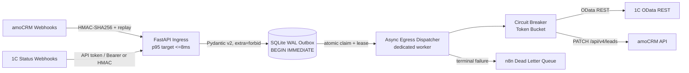

# amoCRM & 1C Resilient Transactional Outbox Gateway

**High-Reliability Async Middleware with Local Persistence, Deterministic Rate Limiting, and Zero Broker Overhead**

-brightgreen)
-yellow)
-blue)
-blue)


**Release gate:** `Tests: 300 passed (strict offline)` · `Coverage: 80% (Critical Path)` · `Contracts: Pydantic v2 Strict (extra="forbid")` · `Storage: SQLite WAL ACID (busy_timeout=5000)` · `Network Boundary: --network=none verified` · `Memory Footprint: <45MB RSS`

**Архитектурный класс.** Асинхронный ingress на FastAPI и SQLite WAL как единственный источник истины. Outbox одновременно является очередью: событие и его delivery-строки фиксируются одной транзакцией `BEGIN IMMEDIATE`. Семантика доставки — at-least-once; каждый attempt эксклюзивен за счёт атомарного claim; дедупликация детерминирована по `idempotency_key` и `UNIQUE(event_id, destination)`. Целостность ingress-плеча подтверждается HMAC-SHA256. Внешних брокеров, dual-write и распределённых транзакций нет.

| Свойство | Значение |
|---|---|
| Ingress | `POST /webhook/amocrm`, `POST /webhook/onec`, `GET /health` |
| Egress | 1C OData REST; amoCRM `PATCH /api/v4/leads/<id>` |
| Очередь | SQLite WAL: `events` + `deliveries` (Transactional Outbox) |
| Гарантия | At-least-once end-to-end; ровно один worker на attempt |
| Брокер | Отсутствует; нет RabbitMQ/Kafka/Redis и dual-write |
| Изоляция | Per-event try/except + отдельный circuit breaker на destination |
| DLQ | n8n webhook, best-effort; `FAILED`-строка остаётся в SQLite |
| Масштабирование | Один `gateway` worker, один `egress-worker` |
| Проверка | 300 тестов, strict offline; детерминированные гонки |

## 1. System Contract

### 1.1. Инварианты, которые нельзя нарушать

| ID | Инвариант | Механизм принуждения | Доказательство |
|---|---|---|---|
| I1 | Событие и его outbox-строки создаются атомарно | `insert_event()` + `BEGIN IMMEDIATE` | `test_insert_event_creates_multiple_destinations`, `test_insert_event_atomic_no_partial_rows_on_failure` |
| I2 | Повторный `idempotency_key` не создаёт второе событие | `UNIQUE(events.idempotency_key)` + `ON CONFLICT DO NOTHING` | `test_insert_event_duplicate_idempotency_key` |
| I3 | На пару `(event, destination)` ровно одна delivery | `UNIQUE(event_id, destination)` | `test_delivery_unique_event_destination` |
| I4 | Один attempt обслуживает ровно один worker | Условный `UPDATE ... WHERE status='VALIDATED'` в `claim_event()` | `test_two_workers_deliver_an_event_exactly_once` |
| I5 | Зависший `DISPATCHED` не теряется | Lease + условный reclaim в `_reclaim_stale_dispatch()` | `test_stale_dispatched_lease_is_reclaimed_but_fresh_one_is_not` |
| I6 | 429/401/403 не размыкают circuit breaker | `classify_status()` → `retry`/`auth`; breaker не вызывается | `test_classify_status_*`, `test_circuit_breaker_is_not_tripped_by_429/401/403` |
| I7 | `Retry-After` — нижняя граница задержки | `max(jitter_backoff, retry_after)` | `test_parse_retry_after_http_date`, `test_retry_after_floor_*` |
| I8 | Один poison pill не останавливает очередь | Per-event `try/except` в `run_worker_pass()` | `test_egress_worker_module_imports_cleanly`, worker isolation path |
| I9 | Сеть недоступна тестам | Autouse `strict_offline` блокирует `socket.socket.connect` | `test_strict_offline_blocks_sockets` |
| I10 | Ошибка всегда имеет 5 полей | `make_error()` + `ErrorShape` | `test_error_shape_five_fields_everywhere` |

### 1.2. Что гарантируется и что не гарантируется

| Утверждение | Статус |
|---|---|
| Событие не потеряется между HTTP 200 и постановкой в очередь | Гарантируется: одна транзакция |
| Два worker-а не выполнят доставку одного события одновременно | Гарантируется: атомарный claim + lease |
| Внешняя система увидит side effect ровно один раз | Не гарантируется: at-least-once; нужны идемпотентные ключи на стороне 1C/amoCRM |
| Порядок доставки между разными событиями | Не гарантируется: очередь выбирает `ORDER BY created_at, id`, но retry может обогнать |
| Сохранность при `SIGKILL` процесса | Гарантируется: WAL + lease reclaim |
| Сохранность при аварии ОС | `synchronous=NORMAL`: последняя транзакция может быть потеряна; для полной durability нужен `FULL` |
| Горизонтальное масштабирование `egress-worker` | Не поддерживается: breaker и токен живут в RAM процесса |
| `GET /health` проверяет 1C/amoCRM/SQLite | Нет; это shallow health для process supervisor |

## 2. Engineering Economics

| Измерение | Инхаус-разработка | Этот репозиторий | Операционное следствие |
|---|---|---|---|
| Время до PoC | 40–80 часов | 6–8 часов | Runbook, Docker Compose и 300 тестов входят в поставку |
| Очередь | Внешний брокер (RabbitMQ, >500 MB RAM) + dual-write | In-process Transactional Outbox, `BEGIN IMMEDIATE`, <45 MB RSS | Нет отдельного кластера, нет расхождения «БД записана — сообщение не отправлено» |
| Тестовая база | 15–30 unit-тестов | 300 тестов: сбои сокетов, 429, 401, дедлоки SQLite, гонки claim | Ошибки воспроизводятся офлайн, без стенда 1C/amoCRM |
| Финансовая модель | Списание ФОТ до сдачи результата | 0 руб. предоплаты за PoC; до 85% маржи генподрядчика | Риск переносится на исполнителя, а не на заказчика |
| Blast radius | Падение брокера останавливает оба плеча | Падение 1C не останавливает приём amoCRM; очередь накапливается локально | Деградация локализована destination-ом |
| Time-to-verify | Сбор стенда и ручные сценарии | 15 минут: pytest + `--network=none` audit container | Аудит воспроизводим на ноутбуке |

> Таблица — модель стоимости и риска, не benchmark конкретного железа. Значения RSS и времени PoC зависят от профиля нагрузки; измеряйте на своём стенде.

## 3. Architecture (C4 Container)



| Container | Ответственность | Состояние | Масштабирование |
|---|---|---|---|
| `gateway` | HTTP-приём, аутентификация, replay guard, валидация, запись outbox | RAM: nonce-журнал, ingress rate-limit buckets; SQLite: `events`, `deliveries` | Один Uvicorn worker (`--workers 1`) |
| `egress-worker` | Claim, доставка, retry, circuit breaker, DLQ | RAM: breaker, amoCRM token epoch; SQLite: статусы delivery | Ровно один экземпляр |
| SQLite WAL | Источник истины и очередь | `events`, `deliveries`, индексы, WAL/SHM | Один writer, конкурентные readers |
| n8n DLQ | Приём терминальных ошибок | Внешний webhook | Best-effort; не является очередью истины |

**Почему ingress и egress разведены.** HTTP-запрос не ждёт 1C OData. Он фиксирует намерение в outbox и возвращает `200`; доставку выполняет отдельный процесс. Это убирает tail latency внешней системы из ingress-плеча и позволяет переживать длительные отказы 1C без потери событий.

**Почему egress dispatcher синхронный.** Воркер использует `httpx.Client`, `threading.Lock` и blocking token bucket. Это осознанный выбор: один процесс, предсказуемая конкуренция, отсутствие event-loop starvation. «Async» в названии относится к развязке ingress/egress, а не к `asyncio` внутри доставки.

## 4. Failure Modes & Self-Healing Matrix

| # | Сценарий | Детектор | Управляющий механизм | Восстановление | Инвариант |
|---|---|---|---|---|---|
| 1 | **amoCRM 429 Too Many Requests** | HTTP 429 + `Retry-After` | Token bucket pacer (audit profile 7 RPS; shipped default 2 RPS), exponential backoff с Full Jitter | `delay = max(jitter, Retry-After)`; 429 не размыкает breaker; retry до `max_attempts` | I6, I7 |
| 2 | **amoCRM 401 Unauthorized** | HTTP 401 на `PATCH` | Single-flight: `threading.Lock` + lazy `asyncio.Lock`, epoch `token_version` | Ровно 1 refresh на эпоху; конкурирующие 401 переиспользуют новый токен; не более 1 replay; второй 401 возвращается наверх | I6 |
| 3 | **1C Socket Timeout / 504** | Transport exception или 5xx | Circuit breaker `CLOSED → OPEN → HALF-OPEN`; `failure_threshold=5`, `cooldown=30s`, probe interval `5s` | Событие остаётся в outbox; worker не падает; после cooldown — один probe; успех закрывает цепь | I5 |
| 4 | **1C Lock Contention / 500** | HTTP 500/5xx, `SQLITE_BUSY` | Concurrency throttle: один dispatcher loop + blocking token bucket; отдельного async semaphore нет, потому что нет fan-out | Full Jitter backoff; 5xx учитывается breaker-ом; очередь не раздувается параллельными вызовами | I6, I7 |
| 5 | **SQLite Database Locked** | `sqlite3.OperationalError: locked/busy` | `PRAGMA journal_mode=WAL`, `synchronous=NORMAL`, `busy_timeout=5000`; `BEGIN IMMEDIATE`; 6 retry-попыток 50→500 ms | Конкуренция превращается в ограниченное ожидание; при невозможности WAL процесс падает fail-closed, а не деградирует молча | I1, I3 |
| 6 | **SIGKILL / Аварийное падение worker** | `DISPATCHED` старше `lease_seconds=300` | `claim_event()` + условный `UPDATE ... WHERE status='DISPATCHED' AND updated_at <= cutoff` | Ровно один worker reclaim-ит строку в `VALIDATED`; свежий lease не отбирается; side effect защищён `X-Idempotency-Key` | I4, I5 |
| 7 | **Poison Pill / Невалидный payload** | `ValidationError` на ingress (422) или schema drift на egress | `extra="forbid"`, per-event `try/except`, retry budget, DLQ | Битое событие не блокирует batch; терминальный отказ уходит в DLQ; при недоступном n8n строка остаётся в SQLite для replay | I8, I10 |

**Правило изоляции.** Отказ одного destination не отменяет второй. У `1c` и `amocrm` отдельные breaker-ы; `dispatch_event()` обрабатывает delivery-строки последовательно и фиксирует итог по каждой. Исключение в одном событии логируется и пропускается, а не завершает проход.

**Правило DLQ.** DLQ — не замена БД. `send_to_dlq()` вызывается best-effort; при ошибке n8n событие уже имеет `FAILED`-строку в SQLite. Оператор может повторить доставку без повторной валидации: `FAILED → VALIDATED` разрешён конечным автоматом.

## 5. Time-to-Verify (15 minutes)

```bash
# 1. Окружение
cp .env.example .env

# 2. Локальный запуск набора из 300 тестов в строгом оффлайне
python -m pip install -e ".[dev]"
pytest -v --disable-warnings

# 3. Запуск верификационного Docker-контейнера без доступа к сети
docker build -t gateway-audit -f Dockerfile.audit . && docker run --rm --network=none gateway-audit
```

Ожидаемый результат шага 2:

```text
300 passed, 1 warning in ~16s
```

**Граница сети.** `tests/conftest.py` содержит autouse-фикстуру `strict_offline`, которая заменяет `socket.socket.connect` на функцию, выбрасывающую `RuntimeError`. Любая попытка теста открыть реальный сокет немедленно валит тест. Сетевые транспорты 1C, amoCRM и n8n инжектируются как callables; `time.sleep` также инжектируется, поэтому backoff не замедляет прогон.

`Dockerfile.audit` добавлен в корень репозитория для оффлайн-аудита с `--network=none`. Для проверки WAL: `python -m pytest -q tests/test_hardening.py -k sqlite`.

### 5.1. Что проверить в первые 15 минут

| Шаг | Команда | Ожидание |
|---|---|---|
| Счёт тестов | `pytest -q` | `300 passed` |
| Сетевой guard | `pytest -q tests/test_verification_suite.py -k strict_offline` | 1 passed |
| WAL-контракт | `pytest -q tests/test_hardening.py -k sqlite` | `journal_mode=wal`, `synchronous=1`, `busy_timeout=5000` |
| Атомарный claim | `pytest -q tests/test_hardening.py -k two_workers` | Ровно один transport call |
| Ротация токена | `pytest -q tests/test_amocrm_token_rotation.py` | 1 refresh на эпоху |
| Compose-конфиг | `docker compose config -q` | exit 0 |

## 6. Navigation Map for Senior Review

| Что проверяет аудитор | Файл | Контракт |
|---|---|---|
| Атомарный claim и WAL-контракт | `gateway/state_store.py` | `connect()`, `transaction()`, `claim_event()`, `_reclaim_stale_dispatch()`, `init_db()` |
| Single-flight ротация токенов под замком | `gateway/amocrm_client.py` | `_token_version`, `refresh_token()`, `async_refresh_token()`, ровно один replay после 401 |
| Rate limiter и Full Jitter backoff | `gateway/resilience.py` | `TokenBucketRateLimiter`, `classify_status()`, `parse_retry_after()`, `retry_after_floor()` |
| Строгие схемы DTO (`extra="forbid"`) | `gateway/contracts/*.py`, `gateway/contract_validator.py`, `gateway/pipeline.py` | `WebhookPayload`, `OneCOrderCreateSchema`, `OneCCounterpartySchema`, `OneCOrderStatusSchema`, `AmoLeadCreateSchema` |
| Трассировка и сквозной `X-Request-ID` | `gateway/observability.py` | ContextVar, `RequestIdFilter`, `JsonFormatter`, middleware в `gateway/app.py` |
| Доменная иерархия исключений | `gateway/errors.py` | `GatewayError`, `StorageError`, `TransportError`, `AuthenticationError`, `RateLimitExceeded`, `TokenRotationError` |
| HTTP-граница и коды ответов | `gateway/app.py` | Два webhook-эндпоинта, `GET /health`, JSON error boundary |
| Оркестрация Ingress → Validate → Store | `gateway/pipeline.py` | `process_webhook()`, `run_delivery_pass()` |
| Валидация и маршрутизация событий | `gateway/contract_validator.py` | `_EVENT_ROUTING`, `delivery_destinations()`, `ErrorShape` |
| Egress: маршрутизация, breaker, DLQ | `gateway/egress_dispatcher.py` | `dispatch_event()`, `_deliver_one()`, `CircuitBreaker`, `send_to_dlq()` |
| Lifecycle воркера и graceful shutdown | `scripts/egress_worker.py` | `run_worker_pass()`, `install_signal_handlers()`, `build_*_transport()` |
| Конфигурация и валидация | `gateway/config.py`, `config/gateway.json`, `.env.example` | `Settings.from_env()`, `Settings.from_file()`, frozen/extra=forbid |
| 300 тестов | `tests/` | 16 модулей, autouse `strict_offline`, детерминированные гонки |
| CI-гейт | `.github/workflows/ci.yml` | `ruff check`, `pytest -q`, `docker compose config -q` |

## 7. Queue Semantics

### 7.1. Конечный автомат события

| From | To | Триггер | Терминальность |
|---|---|---|---|
| — | `RECEIVED` | Первичная вставка `insert_event()` | Нет |
| `RECEIVED` | `VALIDATED` | Валидация и коммит outbox | Нет |
| `VALIDATED` | `DISPATCHED` | `claim_event()` выиграл условный UPDATE | Нет |
| `DISPATCHED` | `DELIVERED` | Все delivery-строки доставлены | Да, до replay |
| `DISPATCHED` | `FAILED` | Исчерпан retry budget или breaker open | Нет, replay разрешён |
| `FAILED` | `VALIDATED` | `resend_failed()` / следующий проход | Нет |
| `DISPATCHED` | `VALIDATED` | Истёк lease, reclaim после падения worker | Нет |

`DELIVERED` не имеет исходящих переходов. `FAILED` не является могилой: это очередь на повторный проход. Именно поэтому `FAILED`-события переотправляются без повторной валидации.

### 7.2. Конечный автомат delivery

| From | To | Триггер |
|---|---|---|
| — | `PENDING` | `insert_event()` атомарно с событием |
| `PENDING` | `IN_FLIGHT` | `mark_delivery_in_flight()` перед вызовом транспорта |
| `IN_FLIGHT` | `DELIVERED` | `finish_delivery()` после 2xx |
| `IN_FLIGHT` | `FAILED` | `finish_delivery()` после исчерпания попыток / breaker open |
| `FAILED` | `IN_FLIGHT` | Повторный проход без повторной валидации |

`UNIQUE(event_id, destination)` делает повторную постановку идемпотентной. `attempt_count` фиксируется на завершении delivery, а не на каждом сетевом вызове. `next_attempt_at` зарезервирован под отложенный retry и в текущей реализации равен `NULL`.

### 7.3. Почему это Transactional Outbox, а не «очередь в памяти»

| Риск | Внешний брокер | Этот outbox |
|---|---|---|
| Событие записано в БД, сообщение не отправлено | Dual-write, нужен outbox поверх брокера | Исключён: одна транзакция |
| Брокер потерял сообщение | Нужна репликация и DLQ | SQLite WAL + `FAILED`-строка |
| Сообщение доставлено, БД откатилась | Возможен phantom event | Исключён: commit до egress |
| Порядок и дедупликация | Зависит от брокера | `ORDER BY created_at, id` + `UNIQUE` |
| Операционная стоимость | Кластер, мониторинг, upgrade | Один файл и два процесса |

**Граница durability.** `synchronous=NORMAL` в WAL durable для падения процесса; при отказе ОС последняя транзакция может быть потеряна. Для сценариев, где потеря последнего webhook недопустима, переключите `synchronous=FULL` и измерьте стоимость fsync. Это единственный параметр, который меняет контракт durability.

## 8. API Surface

| Endpoint | Аутентификация | Назначение | Коды |
|---|---|---|---|
| `POST /webhook/amocrm` | `X-Signature: HMAC-SHA256(raw body)` + `X-Timestamp` + `X-Nonce` | amoCRM → 1C: `lead`, `order`, `counterparty` | `200`, `401`, `403`, `422`, `429` |
| `POST /webhook/onec` | `X-Api-Token` / `Authorization: Bearer` **или** `X-Signature` HMAC; replay guard обязателен | 1C → amoCRM: `onec_order_status` | `200`, `401`, `403`, `422`, `429` |
| `GET /health` | Нет | Shallow process health | `200` |

**Успешный приём:**

```json
{"status": "validated", "event_id": 42, "destinations": ["1c"]}
```

**Идемпотентный дубликат:**

```json
{"status": "duplicate", "event_id": 42}
```

**Ошибка — ровно 5 полей:**

```json
{
  "type": "security|schema|semantic|dependency|storage|configuration|internal",
  "message": "human readable",
  "severity": "critical|warning",
  "location": "headers|body|signature|replay|rate_limit|egress.onec|egress.amocrm|egress.amocrm.rate_limit",
  "how_to_fix": "concrete corrective action"
}
```

`GET /health` не проверяет SQLite, 1C или amoCRM. Он отвечает `{"status":"ok","service":"amocrm-1c-gateway"}` и используется Docker `HEALTHCHECK`. Для проверки очереди используйте SQL из `docs/MAINTENANCE.md`, а не health-эндпоинт.

## 9. Configuration

Все пороги читаются из `Settings`; в бизнес-модулях нет захардкоженных значений. Источники: `config/gateway.json` (4 секции, 13 параметров) и `GATEWAY_*` env (flat scalar keys). Приоритет: explicit env → process env → `config/gateway.json` → safe defaults.

| Параметр | Default | Влияние |
|---|---|---|
| `GATEWAY_BUSY_TIMEOUT_MS` | `5000` | Ожидание writer-lock до `SQLITE_BUSY` |
| `GATEWAY_DISPATCH_LEASE_SECONDS` | `300` | Окно reclaim-а зависшего `DISPATCHED` |
| `GATEWAY_DISPATCH_BATCH_LIMIT` | `50` | Событий на один проход worker-а |
| `GATEWAY_POLL_INTERVAL` | `2` | Пауза между проходами |
| `backoff.base_seconds` | `0.5` | База экспоненты |
| `backoff.multiplier` | `2.0` | Рост задержки |
| `backoff.max_seconds` | `30.0` | Потолок задержки |
| `backoff.jitter_ratio` | `1.0` | `1.0` = Full Jitter |
| `backoff.max_attempts` | `5` | Retry budget до `FAILED`/DLQ |
| `circuit_breaker.failure_threshold` | `5` | Подряд failures до `OPEN` |
| `circuit_breaker.cooldown_seconds` | `30.0` | `OPEN` → `HALF-OPEN` |
| `circuit_breaker.half_open_probe_interval` | `5.0` | Не более одного probe в интервал |
| `replay_guard.timestamp_window_seconds` | `300` | Окно свежести `X-Timestamp` |
| `replay_guard.nonce_journal_size` | `10000` | Bounded nonce set |
| `rate_limit.requests_per_window` | `100` | Ingress budget на IP |
| `rate_limit.window_seconds` | `60` | Окно ingress budget |
| `GATEWAY_AMOCRM_REQUESTS_PER_SECOND` | `100` | Client-side amoCRM budget |
| `GATEWAY_ONEC_RATE_LIMIT_RPS/BURST` | `2.0 / 5` | 1C pacer |
| `GATEWAY_AMOCRM_RATE_LIMIT_RPS/BURST` | `2.0 / 5` | amoCRM pacer; audit profile 7 RPS задаётся явно |
| `GATEWAY_ONEC_TIMEOUT_SECONDS` | `15` | Per-request timeout 1C/amoCRM |

**Секреты.** `GATEWAY_HMAC_SECRET`, `GATEWAY_ONEC_API_TOKEN`, `GATEWAY_ONEC_USER/PASSWORD`, `GATEWAY_AMOCRM_ACCESS_TOKEN` не хранятся в коде и не должны попадать в образ. `GATEWAY_HMAC_SECRET=change-me-in-production` — только локальный default; production-старт должен его заменить.

## 10. Deterministic Testing

| Механизм | Как реализован | Что ловит |
|---|---|---|
| Offline boundary | Autouse `strict_offline` блокирует `socket.connect` | Случайный реальный HTTP-вызов |
| Transport injection | `OneCClient`/`AmoClient` принимают callable | Детерминированные 200/401/429/500/timeout |
| Time injection | `sleep_fn` и `clock` передаются в retry/pacer | Backoff без реального ожидания |
| Race determinism | `threading.Barrier`, `ThreadPoolExecutor`, `Lock` | Два worker-а на одном событии |
| SQLite concurrency | 50 параллельных worker-ов + `BEGIN IMMEDIATE` | `database is locked`, потерянные обновления |
| Token epoch | `token_version` + concurrency barrier | N параллельных 401 → 1 refresh |
| WAL contract | Явные `PRAGMA` assertions | Случайная деградация journal mode |
| Observation | `X-Request-ID` echo + JSON logs | Потеря корреляции между ingress и egress |

**Структура набора.** 16 модулей; ключевые группы: `test_resilience.py` (pacing, status classes, Retry-After), `test_amocrm_token_rotation.py` (single-flight), `test_hardening.py` (claim, lease, WAL, request id), `test_onec_throttling.py` (429/5xx), `test_deliveries_store.py` (outbox), `test_verification_suite.py` (A1–A16 invariants).

**CI.** `.github/workflows/ci.yml` запускает `ruff check`, `pytest -q` и `docker compose config -q` на Python 3.10. CI не публикует образ и не выполняет `git push`; релизный аудит — отдельный `Dockerfile.audit` прогон с `--network=none`.

## 11. Operational Boundaries

| Ограничение | Причина | Действие |
|---|---|---|
| Один `egress-worker` | Breaker и token epoch — in-process state | Не масштабировать горизонтально; для ёмкости оптимизируйте pacer/батч |
| Один Uvicorn worker | In-memory replay guard и rate-limit buckets не разделяются между процессами | `--workers 1`; для HA используйте внешний балансировщик с sticky sessions или вынесите guard в общий store |
| Replay guard теряется при рестарте | Nonce-журнал в RAM | В окне 300 с возможен повтор nonce; для строгого контракта нужен persistent nonce store |
| Ingress rate-limit теряется при рестарте | Buckets в RAM | Всплеск 429 после рестарта; это допустимый fail-safe |
| SQLite только на local FS | WAL требует корректных lock-ов | Не размещать `gateway.db` на NFS/SMB; процесс fail-closed при отказе WAL |
| DLQ best-effort | n8n webhook может быть недоступен | `FAILED`-строка остаётся в SQLite; replay после восстановления n8n |
| At-least-once | Crash после side effect, но до `finish_delivery` | `X-Idempotency-Key` + маркер `[idempotency-key:...]` в 1C; ключ в amoCRM |
| Shallow `/health` | Не создаёт нагрузку на зависимости | Мониторить `deliveries` SQL и глубину `FAILED`, а не только HTTP 200 |

**Границы, которые не прячутся.** Это не exactly-once система и не распределённая очередь. Это локальный, детерминированный, аудируемый outbox для двух интеграционных плеч. Если требуется exactly-once на стороне 1C/amoCRM, идемпотентность должна быть реализована в принимающей системе; gateway даёт для этого ключ и повторяемую семантику.

## 12. Documentation

| Документ | Для чего |
|---|---|
| [`docs/MAINTENANCE.md`](docs/MAINTENANCE.md) | Дежурный runbook: первые 60 секунд, SQL-рецепты Outbox, миграции, симптомная матрица |
| [`docs/INTEGRATION_MANUAL.md`](docs/INTEGRATION_MANUAL.md) | Подключение amoCRM/1C/n8n, HMAC, replay, OData, обратное плечо |
| [`DEPLOYMENT_GUIDE.md`](DEPLOYMENT_GUIDE.md) | Production deployment, systemd, Docker Compose, backup |
| [`ARCHITECTURE_REPORT.md`](ARCHITECTURE_REPORT.md) | C4-компоненты, конечные автоматы, трассировка критериев A1–A16 |
| [`OPENAPI_SPEC.json`](OPENAPI_SPEC.json) | Машиночитаемый контракт HTTP API |
| [`docs/research/ingress_signature.md`](docs/research/ingress_signature.md) | Формальная семантика подписи и replay |
| [`docs/research/egress_contracts.md`](docs/research/egress_contracts.md) | Контракты 1C OData и amoCRM egress |
